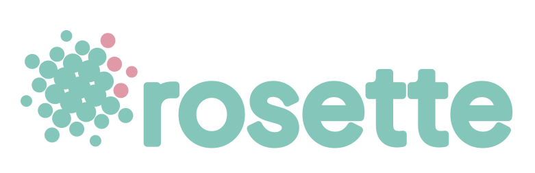

---


[](https://pypi.org/project/rosette-halftone/)
[](https://pypi.org/project/rosette-halftone/)
[](LICENSE)

Convert a color image into CMYK-separated halftone SVG files — one per channel, each a pure vector circle halftone at the correct screen angle.

Built for screen printing, risograph, and any print workflow where you need clean per-channel separations as scalable vector art.

A web-based version of this tool for monochrome halftones can be found at **[palettary.com/halftone](https://palettary.com/halftone)**.


<br>

## What Rosette Does

Rosette takes a color image and produces four standalone SVG plates plus a composite preview:

| File | Contents |
|------|----------|
| `cyan.svg` | Cyan channel halftone dots |
| `magenta.svg` | Magenta channel halftone dots |
| `yellow.svg` | Yellow channel halftone dots |
| `black.svg` | Black channel halftone dots |
| `sample.png` | All channels composited — a quick calibration preview |

Each SVG contains only that channel's dots as `<circle>` elements on a transparent background. Load them into Inkscape or Illustrator, or send them directly to a print workflow.

Unlike raster-output halftone tools, Rosette's plates are resolution-independent — scale them to any print size without quality loss. Isolated per-channel vector plates are the whole point: a composited raster preview can't be burned to a screen or sent to a riso drum, but these SVGs can.


<br>

## Installation

<div align="center">
<h3>Choose your Python level</h3>

<a href="#pyPro">
</a>&nbsp;&nbsp;&nbsp;
<a href="#pyNoob"></a>
</div>

<br />

### <div id="pyPro">Python Pro💪</div>

Rosette is on PyPI as [rosette-halftone](https://pypi.org/project/rosette-halftone/). To install:

```bash
pip install rosette-halftone
```

The CLI command is `rosette`. Requires Python 3.10+. All dependencies install automatically.

<br />

### <div id="pyNoob">Python Beginner🤷</div>

Rosette has no app icon or window — you type commands into a terminal and it writes files. That's less scary than it sounds. Total setup is two steps, about five minutes, and you only do it once.

<details>
<summary><strong>Windows</strong></summary>

**Step 1 — Install Python.** Download it from [python.org/downloads](https://www.python.org/downloads/) and run the installer. On the first screen, **check the box that says "Add python.exe to PATH"** — this is the one step people miss, and nothing works without it.

**Step 2 — Install Rosette.** Open a terminal: press the Windows key, type `cmd`, press Enter. In the black window, type:

```
pip install rosette-halftone
```

**Check it worked:**

```
rosette --help
```

If you see a list of options, you're done. If you see "rosette is not recognized," close the terminal, reopen it, and try again (the PATH change needs a fresh window).

</details>

<details>
<summary><strong>macOS</strong></summary>

**Step 1 — Install Python.** Download it from [python.org/downloads](https://www.python.org/downloads/) and run the installer. (macOS ships with an old Python you shouldn't use — install the real one.)

**Step 2 — Install Rosette.** Open Terminal (press Cmd+Space, type `terminal`, press Enter) and type:

```
pip3 install rosette-halftone
```

**Check it worked:**

```
rosette --help
```

If you see a list of options, you're done.

</details>

<details>
<summary><strong>Linux</strong></summary>

Modern Debian/Ubuntu block `pip install` outside a virtual environment ("externally-managed-environment"). Use [pipx](https://pipx.pypa.io/) instead — it gives you the global command without the error:

```bash
sudo apt install pipx
pipx ensurepath
pipx install rosette-halftone
```

Open a new terminal, then check with `rosette --help`.

</details>

<br />

### Your first separation
Now that you have everything installed, let's run an image through Rosette. 

1. Put an image somewhere easy, like your Desktop — say `photo.jpg`.
2. In the terminal, move to that folder:
   - Windows: `cd Desktop`
   - macOS/Linux: `cd ~/Desktop`
3. Run:
   ```
   rosette photo.jpg
   ```
4. Look in the new `output` folder on your Desktop: four SVG plates (`cyan`, `magenta`, `yellow`, `black`) and a `sample.png` preview. Open the SVGs in Illustrator, Inkscape, or Figma.

<br />

### Understanding Options

Now let's dig a little deeper. When you run a command-line tool, anything you add after the command name changes how it behaves. Take this example:

```
rosette --dots 100 image.jpg
```

Breaking that down:

- `rosette` is the command — the tool you're running.
- `image.jpg` is the **argument** — the thing Rosette acts on (your image).
- `--dots` is an **option** — a setting you're adjusting.
- `100` is the **value** you're giving that option.

Options start with dashes: a single `-` for one-letter shortcuts, and two `--` for full words (like `--dots`). Some options don't take a value at all — they're simply on or off. Those are often called **flags**. Rosette's `--zip` is one: add it and you get a ZIP, leave it off and you don't.

The two options you'll reach for most are `--dots` (how fine the dot grid is) and `--gamma` (how heavy the ink sits) — both explained below.


<br />

## Usage

```
rosette IMAGE [OPTIONS]
```

`IMAGE` is a PNG, JPG, TIFF, or WEBP file.

### Options

| Option | Default | Description |
|--------|---------|-------------|
| `--dots INTEGER` | 100 | Dots per row (controls grid density) |
| `--preset TEXT` | `us` | Screen angle preset (see table below) |
| `--angles C M Y K` | — | Manual per-channel angles in degrees; overrides `--preset` |
| `--profile TEXT` | `math` | CMYK conversion method: `math` or `swop` (see below) |
| `--gamma FLOAT` | 1.5 | Dot density curve. Higher = lighter, more open halftone; lower = heavier |
| `--tac FLOAT` | 220 | Total Area Coverage limit (%) — caps total ink per pixel |
| `--min-radius FLOAT` | 0 | Minimum dot radius as a fraction of max radius (0–1) |
| `--channels TEXT` | `cmyk` | Channels to generate: any combo of `c`, `m`, `y`, `k` |
| `--resample TEXT` | `linear` | Sampling kernel: `nearest`, `linear`, `lanczos2`, `lanczos3`, `spline36` |
| `--output DIR` | `./output` | Output directory |
| `--zip` | off | Package all output (SVGs + sample.png) into a single ZIP |

### Choosing a conversion profile (`--profile`)

Rosette offers two ways to split RGB into CMYK:

- **`math`** (default) — a direct geometric formula (`K = 1 − max(R,G,B)`, with C/M/Y as the remainder). Produces moderate, neutral, predictable ink values. Recommended for screen printing and risograph, where inks and stocks differ from commercial offset.
- **`swop`** — ICC-accurate conversion through the bundled Artifex CMYK SWOP profile via lcms2. If the input image has an embedded ICC profile (AdobeRGB, Display P3, etc.) it is honored; otherwise sRGB is assumed. SWOP is calibrated for coated offset stock and runs ink heavy by design — pair it with lower `--tac` and higher `--gamma`. Choose this when handing files to an offset prepress workflow that expects SWOP separations.

Images that are already CMYK (e.g. CMYK TIFFs) are used as-is with either setting.

### Tuning dot weight (`--gamma`)

Gamma reshapes how ink density maps to dot size, exactly like a press operator adjusting for dot gain:

- `--gamma 1.0` — straight mapping; dense, heavy plates
- `--gamma 1.5` — the default; opens highlights into clean dot gradients
- `--gamma 2.0` — light and airy; can blow out highlights on bright images
- Below `1.0` — pushes coverage heavier (bold, inky look)

Dark, shadow-heavy images often benefit from `1.5–2.0` to recover detail. Bright images may want `1.0–1.3`. There is no upper clamp — but beyond ~3.0 most images lose too much ink to read.

### Limiting total ink (`--tac`)

Total Area Coverage caps the sum C+M+Y+K per pixel, scaling all four channels down proportionally (hue is preserved). Guidelines: screen printing 160–200, risograph 180–220, coated offset up to 300. The default 220 suits most screen/riso work.

### Setting dot density (`--dots`) and LPI

Because Rosette outputs SVG, LPI is not fixed at generation time — it's determined by how large you print the file. The relationship is simple:

> **`--dots` = target LPI × print width in inches**

| Target LPI | 4" wide | 5" wide | 8.5" wide | 11" wide | 17" wide |
|------------|---------|---------|-----------|----------|----------|
| 35 lpi     | 140     | 175     | 298       | 385      | 595      |
| 45 lpi     | 180     | 225     | 383       | 495      | 765      |
| 55 lpi     | 220     | 275     | 468       | 605      | 935      |
| 65 lpi     | 260     | 325     | 553       | 715      | 1105     |
| 85 lpi     | 340     | 425     | 723       | 935      | 1445     |

Typical ranges by process: **screen printing** 35–65 lpi · **risograph** 50–106 lpi · **offset** 85–150 lpi.

**Image resolution note:** for clean dot gradients, your input image should be at least `--dots × 2` pixels wide. Below that, cell size drops under 2px and the blur/sampling pipeline has too little data to work with.

### About sample.png

`sample.png` is a quick composite of all active channels rendered at a fixed scale — `--dots` × 4 pixels wide — so each dot cell is about 4px across and the image reads correctly at 100% zoom regardless of input resolution. Use it to sanity-check dot size, screen angles, and tonal range before opening the SVG plates.

It is a calibration aid, not a print proof: it approximates ink overlap with a simple CMYK→RGB conversion and won't match the color fidelity of a press proof or a dedicated raster halftone tool. Judge final quality from the SVG plates themselves.

### Examples

```bash
# Basic — math profile, US angles, 100 dots per row, gamma 1.5
rosette photo.jpg

# Higher density, EU angle preset
rosette photo.jpg --preset eu --dots 150

# Dark image — open up the shadows
rosette nightshot.jpg --dots 150 --gamma 1.75

# ICC SWOP separation for offset prepress, with ink limiting
rosette photo.jpg --profile swop --tac 180 --gamma 1.5

# CMY only, no black plate, custom output directory
rosette photo.jpg --channels cmy --output ./separations

# High-density black-only plate (single-color screen print)
rosette photo.jpg --channels k --dots 200 --output ./black-plate

# Manual screen angles
rosette photo.jpg --angles 15 75 0 45

# Package everything into a ZIP
rosette photo.jpg --zip
```

---

## CMYK Screen Angles

Halftone screens are rotated to prevent moiré patterns when the four color layers overlap. The classic approach assigns each channel a different angle:

| Preset | C  | M  | Y  | K  | Notes |
|--------|----|----|----|----|-------|
| `us`   | 15 | 75 | 0  | 45 | US standard — default |
| `eu`   | 15 | 45 | 0  | 75 | European standard |
| `alt-a`| 15 | 45 | 30 | 45 | |
| `alt-b`| 45 | 15 | 0  | 75 | |
| `alt-c`| 45 | 75 | 0  | 15 | |
| `alt-d`| 75 | 15 | 0  | 45 | |
| `alt-e`| 75 | 45 | 0  | 15 | |
| `alt-f`| 75 | 15 | 60 | 45 | |

**Why it matters:** when two halftone screens at similar angles are overlaid, their dot patterns interfere and produce a visible grid artifact (moiré). Traditional offset printing separates the dominant inks (K and M) by 30°, with C 15° from K and Y on the least-visible 0° angle. Different presets trade off moiré characteristics — try `eu` if `us` shows artifacts on your specific press or paper.

For risograph and screen printing, angle choice also affects ink mixing behavior. Experimenting with the alt presets can produce different visual texture in overlapping color areas.

---

## How It Works

1. **Load and convert** — Pillow opens the image and converts RGB to CMYK using the selected `--profile`: the geometric `math` formula (default), or ICC conversion through the bundled Artifex SWOP profile via ImageCms/lcms2 (honoring any embedded input profile). CMYK input files skip conversion entirely.
2. **TAC limiting** — any pixel where C+M+Y+K exceeds the `--tac` threshold is scaled down proportionally, preserving hue.
3. **Pre-blur** — each channel is Gaussian-blurred at radius = cell_size/2 before sampling, smoothing tonal transitions into clean dot gradients.
4. **Rotated grid** — a dot grid is generated at the channel's screen angle, sized to cover the full image diagonal so no edge is missed at any rotation.
5. **Sampling** — each dot's ink density is sampled from the blurred channel at the dot centre using the `--resample` kernel (bilinear by default).
6. **Gamma & radius mapping** — density passes through the `--gamma` curve, then maps to dot radius with area-proportional (square-root) scaling so ink coverage stays linear with density. Maximum radius is `cell_size × 0.47`, keeping adjacent dots from merging in SVG solid-fill rendering.
7. **Output** — each channel becomes a standalone SVG of `<circle>` elements on a transparent background, plus a fixed-scale `sample.png` composite for calibration.

---

## License

AGPL-3.0-or-later. See [LICENSE](LICENSE).

## Acknowledgements

- Bundled ICC profiles (`sRGB.icc`, `SWOP.icc`) are provided by [Artifex Software](https://www.ghostscript.com/) as part of GPL Ghostscript, distributed here under AGPL-3.0.
- Halftone approach and Pillow/ICC pipeline referenced from [curegit/halftone-converter](https://github.com/curegit/halftone-converter).
- Sampling and grid approach informed by [evestera/svg-halftone](https://github.com/evestera/svg-halftone).
