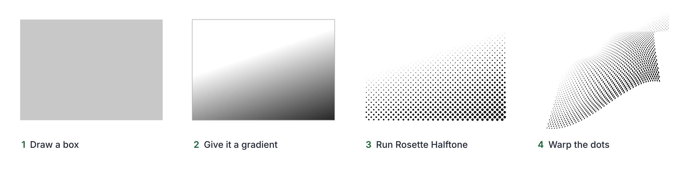

# Rosette for Affinity

A script for Affinity 3.3 or later that turns the selected object into a black halftone made of
true vector circles, using Rosette's dot math. It doesn't rasterize the result or trace it: every
dot is an exact ellipse at the size Rosette calculates.



Because the dots are real shapes, Affinity's vector tools keep working on them: the warp in step 4
was made with Affinity's warp tools, straight from the script's dots.

Affinity's scripting is in beta, so a future Affinity update may need the script updated too.

## Install

The script comes two ways, and either one works:

- [`Rosette Halftone v1.0.afscript`](Rosette%20Halftone%20v1.0.afscript), exported from Affinity,
  ready to import.
- [`src/rosette.js`](src/rosette.js), the same script as plain JavaScript, to paste into Affinity's
  Script Editor.

The script doesn't read your files, use the network or use Canva AI, so it needs none of those
permissions.

The steps below follow Affinity's own help pages, [Running scripts](https://www.affinity.studio/help/running-scripts/)
and [Trusting scripts](https://www.affinity.studio/help/trusting-scripts/). Affinity's scripting is
in beta, so if a menu or button below doesn't match your copy of Affinity, those pages have the
current steps.

### Turn on scripting (once)

Scripting is off in Affinity until you turn it on.

1. Select **Affinity ▸ Settings** (Mac) or **Edit ▸ Settings** (Windows).
2. Select **Scripting**, then select **Enable Affinity Scripting**.

The scripting panels are on the **Window** menu under **Scripting**: you'll use the **Scripts
Library** panel and, for the paste method, the **Script Editor** panel.

### Method 1: import the .afscript file

1. Download `Rosette Halftone v1.0.afscript`.
2. On the **Scripts Library** panel, open the options menu of the category you want it in (the icon
   next to the category name), then select **Import Script**.
3. Select the `.afscript` file, then select **Open**.

Affinity marks every imported script as untrusted, shown by an alert icon beside it. The first time
you run it, Affinity asks what to do: select **Trust & Run**. Or trust it ahead of time: right-click
it (⌃-click on Mac) on the Scripts Library panel and select **Mark as Trusted**. If you'd like to read
the code first, select **Show in Editor** in that same dialog.

### Method 2: paste the JavaScript

1. Open [`src/rosette.js`](src/rosette.js) and copy all of it.
2. On the **Script Editor** panel, select **New Script**, then paste into the code area.
3. Select **Save As**, name it **Rosette Halftone**, add a description, choose a category, then
   select **Save**.

The script appears on the Scripts Library panel. A script you paste and save yourself is trusted
straight away.

More Affinity scripts by the same author, Block Shadow and Sticker Outline, are in
[affinity-scripts](https://github.com/datatimp/affinity-scripts).

## Use

1. Select one object: a shape, a gradient, a placed image or a group. To halftone several objects
   together, group them first.
2. Run **Rosette Halftone**. The dialog previews the dots live on the canvas:
   - **Cell size:** the distance between dot centres.
   - **Angle:** the screen angle; 45° is the usual angle for black.
   - **Gamma:** above 1 opens up the highlights (smaller dots in light areas); below 1 makes
     the dots heavier. 1.5 is Rosette's default.
   - **Minimum dot (%):** the smallest dot drawn in any inked area, as a percentage of the largest
     dot. White stays bare paper either way.
   - **Dots as:** one compound shape (lightest, easiest to recolor) or separate dots in a group.
3. Click **OK**. The dots are added above the object, named "Rosette halftone", in one undo step.
   The object itself is unchanged; hide or delete it if you only want the dots.

## How it works

The script renders the object to pixels in memory, with its fills and effects as they show on the
canvas, without changing the document. Very large art is rendered at a reduced scale, up to about
4 million pixels, which keeps it fast. Then it runs Rosette's math:

- a Gaussian blur of half a cell,
- a square grid rotated to the screen angle and centred on the object,
- one sample per dot, with gamma, and
- a dot whose area grows with the ink, up to 0.47 of a cell so that dots never touch.

Transparent areas count as white paper, and the image's edge is extended rather than faded. So a
shape's edge never gets a border of heavy dots, unlike Affinity's Live Halftone filter.

## Limits

- Black only. CMYK plates are planned.
- It runs once. To change the settings, undo and run it again.
- Colors are read as brightness: a color's lightness decides the dot size.

## Other Scripts

Find my other Affinity scripts [here](https://github.com/datatimp/affinity-scripts). Those scripts include:
- Block Shadow
- Sticker Outline

## Tests

The dot math is checked against Rosette's Python, so the two stay in step. From the repo root:

```bash
node --test affinity/test
```

`affinity/test/fixture.json` holds the Python's dots for a few test cases. After changing
Rosette's dot math, regenerate it and commit it:

```bash
PYTHONPATH=src .venv/bin/python affinity/test/make_fixture.py
```

## License

AGPL-3.0-or-later, as the rest of Rosette.
